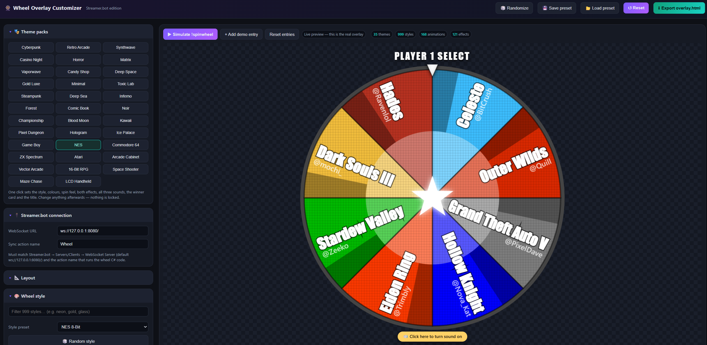

# Streamer.bot Wheel Overlay — Setup



Three pieces:

| File | What it is |
|---|---|
| `wheel-customizer.html` | Open in any browser. Design the wheel, hit **Export overlay.html**. |
| `overlay.html` | What you exported. Goes in OBS as a browser source. |
| `StreamerBot-Wheel.cs` | Paste into one Streamer.bot C# action. Holds the database. |

---

## 1. Streamer.bot — turn on the WebSocket Server

`Servers/Clients` → `WebSocket Server` → **Enabled**, address `127.0.0.1`, port `8080`.
Tick **Auto Start**. That's the address the overlay connects to (`ws://127.0.0.1:8080/`).

Also tick **Allow actions to be executed** (or "Allow DoAction") if your version has it —
that lets the overlay ask for the current entry list the moment OBS loads it. If you can't
find the setting, don't worry: the overlay fills in on the next `!addwheel` or `!spinwheel`.

## 2. Create the action

1. `Actions` → right-click → **Add** → name it exactly **`Wheel`**.
   (If you name it something else, change "Sync action name" in the customizer to match.)
2. Right-click the action's sub-action pane → **Add Sub-Action** → `Core` → `C#` → `Execute C# Code`.
3. Delete the template code, paste everything from `StreamerBot-Wheel.cs`, click **Compile**.
   You should get *Compiled successfully*.

## 3. Add the commands

`Commands` → **Add** for each of these, and set each one's **Action** to `Wheel`:

| Command | Who | Does |
|---|---|---|
| `!addwheel` | everyone | Puts their item on the wheel |
| `!wheel` | everyone | `!wheel add X`, `!wheel remove`, `!wheel list`, `!wheel spin` |
| `!removewheel` | everyone | Takes their own entry back off |
| `!wheellist` | everyone | Prints what's on the wheel |
| `!spinwheel` | mods | Spins it |
| `!clearwheel` | mods | Wipes the wheel |

Set each command's **Location** to `Stream Chat`, and leave "Include commands in..." as you like.
Permissions are also enforced in the code (`MODS_ONLY_SPIN`), so it's fine to leave the command
itself open to everyone.

## 4. Export and add the overlay

1. Open `wheel-customizer.html` in your browser.
2. Design it. The preview on the right **is** the overlay — not a mock-up.
3. Click **Export overlay.html** and save it somewhere permanent (not Downloads).
4. OBS → `+` → **Browser** → tick **Local file** → pick `overlay.html`.
   - Width/Height: your canvas size (e.g. 1920 × 1080)
   - **Untick** "Shutdown source when not visible"
   - **Untick** "Refresh browser when scene becomes active" (optional, but it keeps the connection alive)
5. Right-click the source → **Interact** isn't needed. Sound plays automatically in OBS.

That's it. Type `!addwheel Grand Theft Auto V` in chat and it should appear.

---

## How the one-entry-per-user rule works

Entries are keyed on the **user ID**, not the name, so renaming doesn't get anyone a second slot.

- `user1` → `!addwheel Grand Theft Auto V` → added.
- `user1` → `!addwheel Minecraft` → *"you already have Grand Theft Auto V on the wheel."*
- `!spinwheel` picks Grand Theft Auto V → it's removed → `user1` can add again.
- `user1` can also free their own slot early with `!removewheel`.

If you don't want people swapping their pick with `!removewheel`, just don't create that command,
or delete the `case "remove":` line from the `switch` in the C# code.

## Where the database lives

`<your Streamer.bot folder>\data\wheel_entries.tsv` — one line per entry, tab separated:

```
id    userId    displayName    item    addedUtc    login
```

Plain text, so you can open it in Notepad, edit it, or back it up. It's written atomically
(temp file then rename), so a crash mid-write can't corrupt it. Delete the file to reset everything.

## Settings in the C# code

All at the top of `StreamerBot-Wheel.cs`:

| Setting | Default | Notes |
|---|---|---|
| `PLATFORM` | `"twitch"` | `"twitch"`, `"youtube"` or `"both"` |
| `ANNOUNCE_DELAY_MS` | `6000` | **Set this to your overlay's spin duration** so chat and the overlay agree |
| `MAX_ITEM_LENGTH` | `60` | Longer entries get trimmed |
| `MAX_ENTRIES` | `40` | `0` = unlimited |
| `BLOCK_DUPLICATE_ITEMS` | `true` | Stops two people adding the same thing |
| `MODS_ONLY_SPIN` | `true` | `false` lets anyone spin |
| `REMOVE_WINNER` | `true` | `false` keeps the winner on the wheel |
| `CHAT_REPLIES` | `true` | `false` = the overlay does all the talking |
| `USE_ANNOUNCE` | `true` | Posts every wheel message as a Twitch **/announce** |
| `ANNOUNCE_COLOR` | `"purple"` | `primary` (your channel colour), blue, green, orange, purple |

After any edit, hit **Compile** again.

## Other actions can use the result

After a spin the code sets, for use in any other Streamer.bot action:

- `%wheelWinnerItem%` / `%wheelWinnerUser%` (arguments, same action)
- global variables `wheelLastWinnerItem`, `wheelLastWinnerUser`, `wheelLastWinnerUserId` (persisted)

Handy for TTS, changing an OBS text source, or pushing the pick into a game queue.

---

## The customizer

**35 theme packs** — one click sets the style, colours, spin feel, both effects, all three sounds,
the winner card and the title together. Cyberpunk, Retro Arcade, Synthwave, Casino Night, Horror,
Matrix, Vaporwave, Candy Shop, Deep Space, Gold Luxe, Minimal, Toxic Lab, Steampunk, Deep Sea,
Inferno, Forest, Comic Book, Noir, Championship, Blood Moon, Kawaii, Pixel Dungeon, Hologram and
Ice Palace — plus eleven retro-gaming packs: **Game Boy, NES, Commodore 64, ZX Spectrum, Atari,
Arcade Cabinet, Vector Arcade, 16-Bit RPG, Space Shooter, Maze Chase and LCD Handheld**, each
pairing the matching hardware palette with the matching chiptune sounds. Nothing is locked
afterwards — a theme is a starting point, not a mode.

**999 wheel styles** — 27 render families across 37 palettes. Seven families are retro-gaming
specific: **DMG** (four-tone posterise over a pixel grid), **8-Bit** (flat blocks with hard shading),
**Home Micro** (chunky horizontal bands), **Vector** (glowing wireframe on black), **LCD** (pale
segment rings), **Dither** (checkerboard shading) and **Marquee** (bulbs running round the rim).
They pair with twelve hardware palettes — Game Boy, NES, Commodore 64, ZX Spectrum, Sega, SNES,
Atari, Maze Chase, Invader, Neo Geo, Game Gear and Famicom. The rest are Flat, Gloss, Neon,
Chrome, Glass, Stripe, Checker, Burst, Ringed, Outline, Candy, Retro, **Circuit** (glowing traces and
a hex core), **Hologram** (iridescent sheen), **CRT** (scanlines and phosphor curve), **Comic**
(halftone dots and heavy ink), **Woodgrain**, **Marble** (veining), **Steel Plate** (diamond
cross-hatch) and **VHS** (chromatic tracking fringe). Each family changes the segment shading, rim,
pointer shape, hub and label treatment — not just the colours. Palettes include Cyberpunk, Arcade,
Synthwave, Horror, Pastel Dream, Midnight, Rainbow, Cosmic, Blood Moon, Matrix, Steampunk, Deep Sea
and Bubblegum alongside the originals. Override any colour yourself with "Use my own segment
colours", and use the filter box to search 500 names (try "cyber", "matrix", "comic").

**120 spin animations** — 20 easing curves (including Elastic, Bounce, Magnet Snap, Tease & Kick,
Ratchet, Stutter Stop) × 6 length profiles (Quick → Hyperspin). Override duration and turn count
separately if you want a specific feel. Plus 12 entrance and 12 exit animations for the wheel itself.

**121 effects** — 30 effect kinds (confetti, fireworks, lightning, shockwave, god rays, digital rain,
coin fountain, plasma, screen shake, zoom punch, colour cycle…) at 4 intensities each, plus None.
Pick one for *while it spins* and a different one for *when it lands*.

**Sounds** — 21 spin beds, 21 winner stings and **15 tick sounds**, all generated in the browser
with WebAudio. No audio files to ship or lose. The tick is the click of the pointer against each
segment as it goes past, so it speeds up and slows down with the wheel on its own — Plastic Clicker
is the default, with Metal Ping, Typewriter, Coin Tick, Laser Tick, Wood Block, Ratchet and more
alongside it. Tick volume is its own slider, separate from master, so you can have a loud clicker
over a quiet bed.

For retro looks there's a matching chiptune set: spin beds 8-Bit Coin Run, Chomp Loop, Invader
March, Handheld Spin, Arp Climb, Blip Scroll and Chip Warble; winner stings Level Clear, Extra Life,
8-Bit Fanfare, Coin Get, Boss Down, Victory Arp and Pixel Chime; ticks Chip Blip, Chomp and
Handheld Tick. All original sequences, nothing sampled or transcribed.

Every sound select has a **▶** button beside it, and there's a **Play the whole spin** button that
runs the bed, the ticks and the sting in sequence so you can hear the full thing before exporting.

**Winner reveal** — 12 card styles × 20 card animations, 5 positions, and a hold time you set in
seconds or minutes.

**Randomize** rolls the whole look including the tick sound. Use **Save preset** / **Load preset** to keep a look as a `.json`, and **Randomize** when you want
the machine to surprise you. Settings also auto-save in your browser, so closing the tab is safe.

Re-export `overlay.html` and refresh the OBS browser source after any change.

---

## Troubleshooting

**Wheel never appears in OBS**
The overlay only shows on `!spinwheel` unless you tick *Keep wheel on screen when idle*. Check the
WebSocket Server is enabled and the URL in the overlay matches it.

**Wheel appears but is always empty**
The overlay asks Streamer.bot for the list on connect via `DoAction`. If your version blocks that,
the list fills in on the next add or spin instead — or just type `!wheellist` then `!addwheel`.

**Compile error: "cannot have multiple base classes"**
Your Streamer.bot adds `: CPHInlineBase` to the class line itself, so the file must say plain
`public class CPHInline` — which it now does. Don't add the base class back.

**Compile error: "CPH does not exist in the current context"**
The opposite case, on an older build. Then change the line to `public class CPHInline : CPHInlineBase`.

**Compile error on `System.Linq` / `FirstOrDefault`**
Streamer.bot doesn't reference `System.Core`, so LINQ isn't available in its C# actions. The code
uses plain loops instead and no longer imports `System.Linq` — if you see this, you're on the old
copy of the file.

**Compile error on `SendYouTubeMessage`**
Your version doesn't have it. Delete that one line in the `Reply()` method near the bottom.

**No sound in the customizer**
Use the **▶** buttons in the Sound section — those play through the panel itself and always work.
The live preview is an iframe, and browsers keep a frame silent until someone clicks *inside that
frame*, so clicking "Simulate !spinwheel" in the toolbar isn't enough on its own. The preview shows
a yellow "Click here to turn sound on" badge; one click anywhere in the preview and it goes away and
stays away. None of this applies to OBS, which plays everything from the start.

**No sound in OBS**
Check the browser source isn't muted in the Audio Mixer, and that "Control audio via OBS" matches
how you monitor. Set master volume above zero in the customizer and re-export.

**Announcements don't appear (normal chat messages instead)**
Twitch only accepts `/announce` from a moderator. Make the sending account a mod in your channel —
if you have `SEND_AS_BOT = true`, that's the bot account. The code falls back to a normal message
when the announce is rejected, so nothing is ever lost. Twitch also rate-limits announcements, so
during heavy `!addwheel` traffic set `USE_ANNOUNCE = false` and keep announcements for the result.

**Chat announces the winner before the wheel stops**
`ANNOUNCE_DELAY_MS` in the C# is shorter than your spin duration. Match them.

**Two people spun at once / wheel jumped**
A new `!spinwheel` always cancels a reveal in progress — that's by design.
